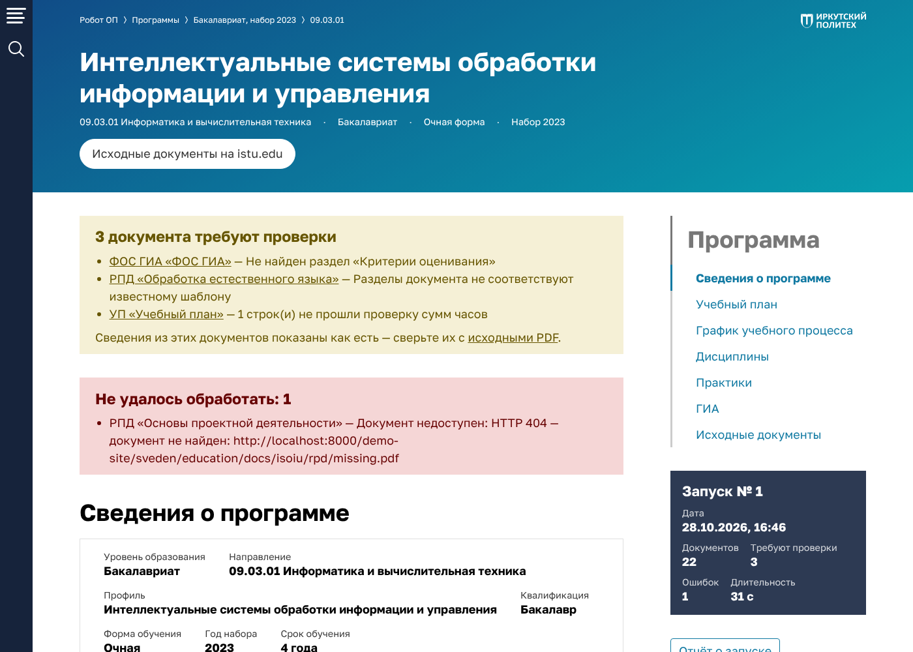

# Робот ОП ИРНИТУ

Программный робот для курсовой работы по дисциплине «Технологии разработки программ роботов»:
**роботизация процесса «Сбор и преобразование документов образовательных программ»** (ТЗ — студент гр. ИСИб-23-1).

Робот по запросу из веб-интерфейса скачивает с сайта ИРНИТУ (раздел «Сведения об образовательной организации.
Образование») документы выбранных ОП — УП, КУГ, РПД, рабочие программы практик, ООП, ФОС ГИА и программу ГИА, —
извлекает из них сведения (текстовый слой или OCR для сканов), проверяет их, сохраняет первичные JSON-файлы,
формирует с помощью LLM краткие описания, сохраняет итоговые JSON-файлы с историей версий и строит веб-страницу ОП:
учебный план в парах в неделю, график учебного процесса, дисциплины, практики, ГИА и ссылки на исходные документы.

Интерфейс сделан по дизайн-системе «Робот ОП ИРНИТУ» (шаблоны и стили из `robot-op-template`, исходник — в `docs/design`).



## Быстрый старт

### Docker (как в ТЗ, раздел 6)

```bash
cp .env.example .env
docker compose up -d --build
```

Откройте http://localhost:8000. Компоненты: `app` (FastAPI + Uvicorn + Tesseract 5 rus/eng), `db` (PostgreSQL 16).
Дополнительно:

```bash
docker compose --profile llm up -d --build      # локальная LLM (Ollama)
docker compose exec ollama ollama pull qwen2.5:7b-instruct
docker compose --profile https up -d --build    # Nginx с HTTPS, сертификаты — deploy/certs
```

Для Ollama в `.env` укажите `ROBOT_LLM_PROVIDER=ollama`; для внешнего сервиса — `ROBOT_LLM_PROVIDER=openai`,
`ROBOT_LLM_BASE_URL`, `ROBOT_LLM_MODEL`, `ROBOT_LLM_API_KEY` (любой OpenAI-совместимый API).

### Без Docker

Нужны Python 3.11+, Tesseract 5 с пакетами `rus` и `eng` (`apt install tesseract-ocr tesseract-ocr-rus`)
и шрифт DejaVu (для демо-сайта).

```bash
pip install -r requirements-dev.txt
python -m robot_op serve            # http://127.0.0.1:8000, база — SQLite в data/robot.db
python -m robot_op serve --demo     # демо-режим без доступа к сайту ИРНИТУ
python -m robot_op pages            # пересобрать страницы ОП по сохранённым JSON (после обновления робота)
```

### Демо-режим

`ROBOT_APP_DEMO=true` (или `serve --demo`) подключает встроенную копию структуры раздела «Образование»
по адресу `/demo-site/`: таблицу уровней и годов (рисунок 1 ТЗ), блоки ОП (рисунок 2), список РПД во всплывающем окне
(рисунок 3), PDF с текстовым слоем и «сканы» УП и КУГ без текстового слоя (рисунки 4, 5). Данные условные.
В них намеренно заложены все альтернативные сценарии ТЗ, чтобы их можно было показать на защите:

| Ситуация в демо-данных | Что делает робот | Статус |
|---|---|---|
| В УП «Ауд.» по физике не равно сумме по семестрам | сведения сохраняются с отметкой | Требует проверки |
| Вместо программы практики размещена аннотация | документ помечается и не обрабатывается | Пропущен |
| РПД «Обработка естественного языка» нового шаблона | помечается, дефектом не является | Неизвестный шаблон |
| В ФОС ГИА нет раздела «Критерии оценивания» | разделы без него заполняются | Частично обработан |
| Ссылка на РПД ведёт на несуществующий файл | повтор, затем отметка «недоступен» | Ошибка |
| У ОП «Прикладная информатика в экономике» нет ссылки на КУГ | предупреждение в журнале | — |

## Как реализованы требования ТЗ

| Шаг (таблица 1 ТЗ) | Реализация |
|---|---|
| 1. Параметры запуска | `/run`: уровни и годы — из таблицы раздела «Образование», ОП — со страницы перечня (`robot/site.py`) |
| 2. Страница перечня ОП | `robot/http.py`: только HTTPS, ≤ 2 запросов/с, повторы с паузой 2–4–8–16 с; при неудаче — сбой запуска с записью в журнал |
| 3. Поиск документов | блок ОП находится по таблице «Уровень / Форма обучения / Год», тип документа — по подписи строки, РПД — из модального окна; ссылки `sig`, адаптированные программы, аннотации, стандарты и программы воспитания отбрасываются |
| 4. Скачивание | условный запрос (ETag / If-Modified-Since) и сравнение SHA-256: неизменившийся документ повторно не скачивается и не переобрабатывается |
| 5. Способ извлечения | проверка формата PDF (файлы не исполняются), проверка соответствия типу по первым страницам, наличие текстового слоя |
| 6. Текстовые документы | `extract/sections.py`: шаблоны разделов РПД, практик, ООП, ГИА, ФОС ГИА; компетенции, объём, семестры, контроль, темы, этапы, литература |
| 7. Сканы УП и КУГ | `extract/grid.py` восстанавливает сетку таблицы по линиям (с объединёнными ячейками), `extract/ocr.py` распознаёт ячейки Tesseract: числа и обозначения — пакетно со словарём символов, текст — по одной ячейке в несколько потоков |
| 8. Проверка | УП: «Ауд.» = сумма по семестрам, «СР» = сумма СР, «По плану» = конт. раб. + СР + контроль, з.е. × 36; КУГ: допустимые обозначения, 52 недели, номера недель. Строки скана, не прошедшие проверку, перечитываются с увеличением |
| 9. Первичный JSON | по каждому документу, со сведениями об ОП со страницы сайта; новая версия — только при изменении |
| 10. Краткое описание | `robot/llm.py`: Ollama или OpenAI-совместимый API; в LLM уходит только первичный JSON; при ошибке итоговый JSON формируется без описания, ошибка — в журнал |
| 11. Итоговый JSON | первичный JSON + краткое описание; история версий (хранится не менее 5, по умолчанию 10) |
| 12. Веб-страница ОП | `robot/page.py`: пары в неделю = часы за семестр ÷ 2 ÷ недели семестра; страница строится по итоговым JSON-файлам |
| 13. Отчёт и журнал | `/reports/<№>` (счётчики по статусам, перечень «требуют проверки», JSON-отчёт), `/log` и `data/logs/robot.log`; журнал хранится за ≥ 10 последних запусков |

Нефункциональные требования: ошибка документа не прерывает запуск; прерванный запуск (остановка пользователем
или перезапуск приложения) продолжается кнопкой «Продолжить запуск» с места остановки; параметры (адреса,
частота запросов, OCR, LLM, сроки хранения) задаются в `config/robot.toml` или переменными окружения
`ROBOT_<РАЗДЕЛ>_<ПАРАМЕТР>` без изменения программы.

## Устройство

```
robot_op/
  config.py            настройки (config/robot.toml + переменные окружения)
  models.py            хранилище: programs, documents, json_versions, runs, run_items, log_entries
  catalog.py           уровни образования, типы документов, статусы
  robot/
    http.py            клиент сайта: HTTPS, белый список хостов, частота запросов, повторы
    site.py            разбор страниц «Образование» и перечня ОП
    pipeline.py        последовательность действий робота (шаги 2–13), продолжение запуска
    llm.py             модуль на основе LLM
    page.py            контекст веб-страницы ОП по итоговым JSON-файлам
    worker.py          фоновое выполнение запусков по очереди
  extract/
    pdf.py             текстовый слой и растр страниц (pdfplumber, pypdfium2)
    grid.py            сетка таблицы по растру
    ocr.py             распознавание ячеек (Tesseract)
    curriculum.py      учебный план: разбор, проверка, матрица «дисциплины × семестры»
    schedule.py        календарный учебный график
    sections.py        документы с текстовым слоем
  web/                 FastAPI, шаблоны Jinja2 и статика дизайн-системы
demo_site/             демо-копия структуры раздела «Образование» и генератор документов
tests/                 pytest
```

Веб-интерфейс: «Запуск робота» → ход запуска и отчёт → «Образовательные программы» (карточки) → страница ОП →
страницы дисциплин, практик и других документов с историей версий JSON-файлов; «Отчёты о запусках»; «Журнал».
Тёмная тема — ссылка в подвале. API (OpenAPI) — `/api/docs`.

### JSON-файлы

Первичный (`schema: robot-op/primary/1`):

```json
{
  "document": {"type": "up", "type_title": "УП", "title": "Учебный план", "url": "https://www.istu.edu/…", "sha256": "…", "pages": 1, "method": "ocr"},
  "program":  {"id": "09.03.01-isoiu-2023-och", "level": "Бакалавриат", "code": "09.03.01", "direction": "…", "profile": "…", "form": "Очная", "year": 2023},
  "status": "needs_review",
  "note": "1 строк(и) не прошли проверку сумм часов",
  "data": {"semesters": [{"number": 1, "weeks": 16}], "rows": [{"index": "Б1.О.05", "name": "Физика", "hours": {}, "semesters": {}, "control": {}, "checks": []}]},
  "robot": {"parser_version": "1.0", "extracted_at": "…", "run": 1}
}
```

Итоговый (`schema: robot-op/final/1`) — то же плюс `summary`, `summary_model`, `final_at`.
Скачать: `/api/documents/<id>/json?kind=primary|final&version=N`.

## Тесты и точность

```bash
python -m pytest -q
```

42 теста: разбор страниц сайта, политика HTTP (только HTTPS, разрешённые хосты, повторы 2–4–8–16 с, без повтора
на 404, ≤ 2 запросов/с), формулы и проверки УП, разбор текстовых документов, сквозной запуск со всеми
альтернативными сценариями, повторный запуск без перекачивания, новая версия JSON при изменении документа,
продолжение прерванного запуска, LLM (включая недоступность модуля), раскладка дисциплин по категориям
и веб-страницы.

`tests/test_ocr_accuracy.py` сверяет распознанные сканы демо-УП и демо-КУГ с исходными данными по порогам
раздела 9 ТЗ (УП — ≥ 95 % чисел и ≥ 98 % наименований, КУГ — ≥ 98 % обозначений). На демо-сканах (300 dpi)
сейчас 100 %; скан УП обрабатывается за 6–10 с, КУГ — за 5–6 с (ТЗ: не более 3 мин и 1 мин).

## Реальный сайт ИРНИТУ

Проверено на www.istu.edu (октябрь 2026): уровни, годы и перечни ОП разбираются; документы наборов 2025–2026
лежат на `app.istu.edu/oop/uploads` и скачиваются, наборов 2022–2024 — на `int.istu.edu`, откуда сайт
перенаправляет на вход ЕСИА, поэтому без учётной записи они помечаются ошибкой.

Реальные сканы УП и КУГ отличаются от демо: перекос и изгиб листа, растровая заливка строк, 600 dpi, мелкая
шапка. Поэтому скан выравнивается по наклону (`grid.skew_angle`), линии сетки ищутся с допуском на изгиб,
ячейки 600-dpi сканов читаются по растру в родном разрешении (`grid.FineRaster`), сомнительные числа
перечитываются несколько раз с голосованием, типичные ошибки OCR в индексах и подписях исправляются.
Проверка УП учитывает правила ИРНИТУ: ЭИОС входит в «Конт. раб.», но не в «Ауд.»; у элективной физкультуры нет з.е.

На странице ОП учебный план показан каруселью по курсам и «полками» категорий (`robot/plan_view.py`):
категория дисциплины определяется по названию набором правил, всё нераспознанное — профессиональные дисциплины.

## Ограничения и что проверить на реальном сайте

- Разбор страниц сайта не привязан к конкретной вёрстке: таблица уровней ищется по названиям уровней, блок ОП —
  по строкам «Уровень / Форма обучения / Год», тип документа — по подписи строки. Если адрес страницы перечня
  ОП перестанет браться из ссылок таблицы, задайте `site.op_list_url_template`.
- Шаблоны разделов РПД, практик, ООП и ГИА (`extract/sections.py`) и раскладка колонок УП (`extract/curriculum.py`)
  составлены по типовой структуре документов; на реальных документах их, вероятно, придётся уточнить —
  для этого и предусмотрены статусы «неизвестный шаблон» и «частично обработан».
- Качество OCR зависит от качества сканов; ручная корректировка данных в функции робота не входит (ТЗ, раздел 8).
- Краткие описания LLM носят вспомогательный характер. Без LLM (`provider = none`) страница ОП показывает фрагмент
  раздела «Общая характеристика» ООП и цели дисциплин из РПД.
